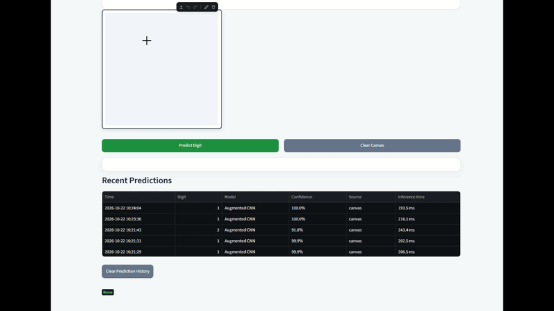

# DigitAI

DigitAI is a TensorFlow/Keras-based handwritten digit recognition project with an interactive Streamlit application. It trains two independent deep learning models using the official MNIST dataset, supports drawing and uploading digit images, and stores prediction records in a local SQLite database.

## 🎥 Project Demonstration

<p align="center">
  
</p>

*The demonstration shows handwritten digit input, prediction results, model comparison, and prediction history.*

## ✨ Key Features

- **Handwritten Digit Recognition:** Recognizes digits from 0 to 9.
- **Draw or Upload:** Accepts digits through a drawing canvas or image upload.
- **Two Deep Learning Models:** Implements and compares LeNet-5 and CNN.
- **Prediction Confidence:** Displays predicted digits and class probabilities.
- **Model Evaluation:** Provides accuracy metrics and confusion matrices.
- **Prediction History:** Stores prediction records using SQLite.
- **Interactive Interface:** Built with Streamlit.

## 🚀 Quick Start

### 1. Create and activate a virtual environment

```powershell
python -m venv .venv
.\.venv\Scripts\Activate.ps1
```

### 2. Install dependencies

```powershell
python -m pip install -r requirements.txt
```

### 3. Train the models

```powershell
python -m src.train --model all --epochs 5
```

### 4. Evaluate the models

```powershell
python -m src.evaluate --model all
```

### 5. Run the application

```powershell
streamlit run app.py
```

MNIST is downloaded by Keras on first use. Models and evaluation reports are generated locally and ignored by Git. No pretrained or legacy model artifacts are used.

## 🗂️ Project Structure

- `app.py` — Streamlit application with Recognize Digit and Model Lab navigation.
- `src/config.py` — Project paths and configuration.
- `src/data.py` — MNIST dataset loading and data splits.
- `src/preprocessing.py` — Image preprocessing for drawn and uploaded digits.
- `src/models.py` — LeNet-5 and CNN model architectures.
- `src/train.py` — Model training.
- `src/evaluate.py` — Model evaluation and report generation.
- `src/inference.py` — Digit prediction and inference logic.
- `src/history.py` — SQLite prediction history management.
- `src/validation.py` — Input image validation.

## 🧪 Verification and Testing

Run the following commands to verify the project:

```powershell
python -m pytest -q
python -m compileall -q src app.py diagnostics
python diagnostics/run_diagnostics.py
```

Train the models before using Model Lab. If model artifacts are missing, the application reports their absence rather than displaying fabricated evaluation metrics.

## 📊 Model Performance

The project uses two models for handwritten digit classification:

| Model | Test Accuracy |
|---|---:|
| LeNet-5 | 97.45% |
| CNN | 98.61% |

*These are the previously reported MNIST test results. Re-run evaluation after training to verify the results for your current model artifacts.*

## 🛠️ Technology Stack

- **Language:** Python
- **Deep Learning:** TensorFlow / Keras
- **Dataset:** MNIST
- **Web Application:** Streamlit
- **Database:** SQLite
- **Image Processing:** Pillow (PIL), NumPy
- **Evaluation:** Scikit-learn, Matplotlib
- **Testing:** Pytest

## 🔮 Future Scope

- Improve recognition of noisy and complex handwritten digits.
- Explore advanced architectures for improved accuracy.
- Extend recognition to handwritten letters and words.
- Deploy the application for online access.

## 👨‍💻 Project

**DigitAI — Handwritten Digit Recognition Using Deep Learning**